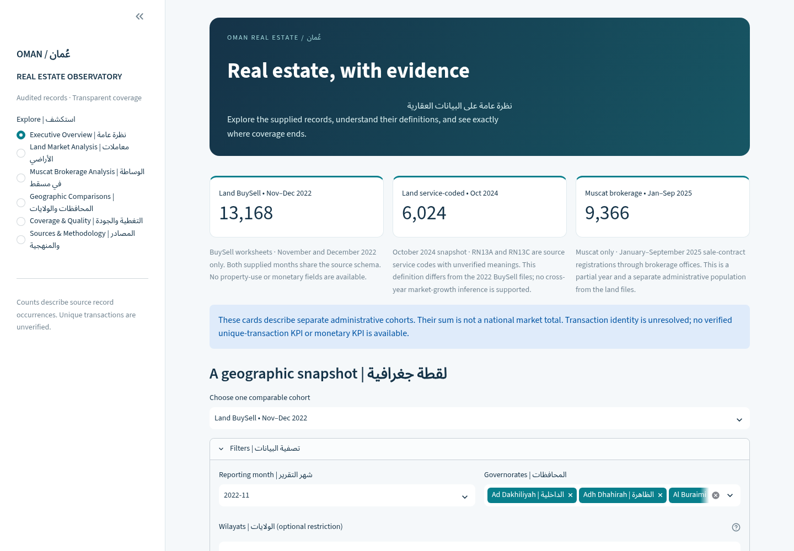
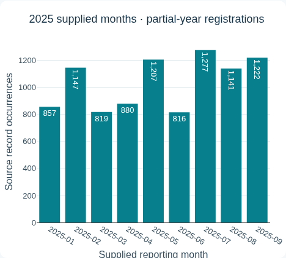
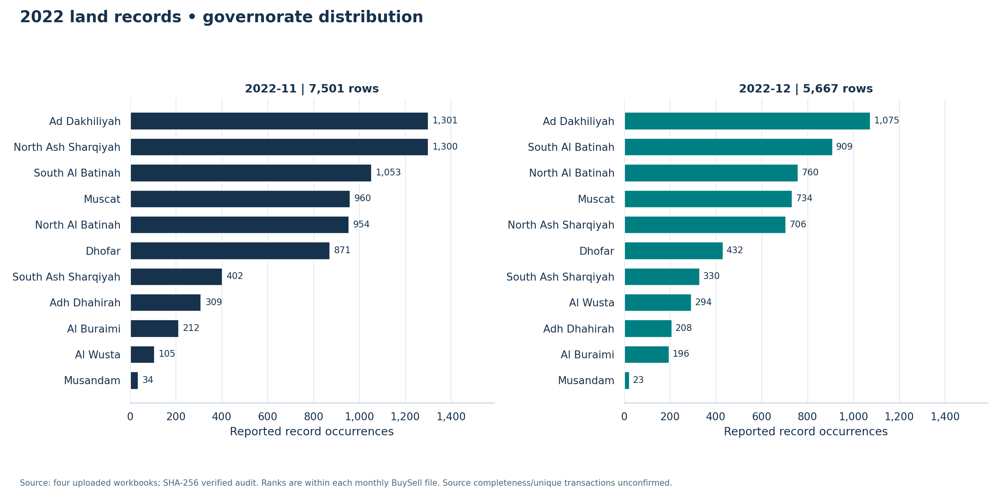

# Oman Real Estate Market Analysis | Python & Streamlit

**Reproducible geographic analysis with Python, an interactive Streamlit dashboard, and Power BI preparation.**

[Dashboard](#live-dashboard) · [Key findings](#key-findings) · [Coverage](#observed-data-coverage) · [Run locally](#setup-and-execution) · [Reproduce](#reproduce-the-analysis) · [Power BI](#power-bi-preparation) · [Provenance](#data-provenance-and-limitations) · [Documentation](#documentation-and-deliverables)

## Executive summary

This portfolio project examines real estate record distributions in Oman using four unchanged, Ministry-attributed Excel uploads. It demonstrates reproducible ingestion, source tracing, data quality auditing, geographic and categorical EDA, and interactive reporting. The files contain **28,558 source record occurrences** across separate land and brokerage populations; this inventory total is **not a national market total or a verified unique-transaction count**.

**2020–2026 is the research target, not the observed dataset coverage.** Current analysis covers November/December 2022 land records, October 2024 service-coded land records, and January–September 2025 Muscat brokerage registrations. Exact official download URLs, applicable licences and market completeness remain unresolved. Findings describe the supplied records; they do not establish prices, investment returns or continuous annual trends.

## Live dashboard

**[Open the Oman Real Estate Observatory](https://oman-real-estate-market-analysis-dq6m4x.streamlit.app)**

**Deployment status:** the repository owner reports the application is live at the URL above. Independent public availability verification is pending: on October 15, 2026, this review environment's proxy returned HTTP 403 before reaching the app, and the web tool could not access it. This is an access limitation, not evidence that the application is down. Local/runtime validation is documented separately below.

The six-page Streamlit app provides Arabic/English labels, interactive filters, Plotly charts, source-occurrence KPIs and selected aggregate CSV downloads:

| Page | What it covers |
|---|---|
| Executive Overview | Separate cohort cards and a one-period geographic snapshot |
| Land Market Analysis | Within-cohort land records, buyer types, ownership bands and literal service codes |
| Muscat Brokerage Analysis | Supplied 2025 months, six wilayats, land-use and property-description distributions |
| Governorate and Wilayat Comparisons | Rankings within one cohort and reporting month |
| Data Coverage and Quality | Missing periods, missingness and duplicate-audit evidence |
| Sources and Methodology | File lineage, attribution, definitions and interpretation limits |

The three populations remain separate. Missing periods are not filled, repeated attributes are retained, and original/processed files are not edited by the app. Runtime checks cover Python **3.12 and 3.14**, including **3.14.8**; physical Android hardware has not been tested.

### Dashboard previews

[](https://oman-real-estate-market-analysis-dq6m4x.streamlit.app)

*Desktop view: separate cohort KPIs and reporting-period controls. Screenshots are repository captures of the locally validated app, not new captures of the public deployment.*

<details>
<summary>View the tablet chart and validated EDA figures</summary>



*Chart captured at a tablet portrait viewport; the nine supplied months are a partial year, not an annual trend.*


*Availability metadata makes the gaps visible; missing periods are not zero activity.*



*Same-layout November/December 2022 snapshots, shown separately. [Browse all 14 figures and PNG/SVG exports](reports/EDA_INDEX.md).*

</details>

## Key findings

These findings are reproduced in the [computed EDA insights](reports/eda/168665c92a8a2ff91598/insights.md) and [executed notebook](notebooks/01_scoped_real_estate_eda.ipynb). Every count below is a **source record occurrence** within its stated file or cohort.

- **2022 land snapshots:** Ad Dakhiliyah has the highest supplied count in November (**1,301**) and December (**1,075**). November's North Ash Sharqiyah count is **1,300**, so the leading rank differs by only one occurrence; it does not establish a meaningful market advantage.
- **October 2024 land snapshot:** North Al Batinah leads with **1,143** occurrences (**18.97%**). North Al Batinah, Muscat and South Al Batinah together account for **3,325** (**55.20%**) of this file. This is within-file concentration, not a cross-year trend or investment ranking.
- **Muscat brokerage, January–September 2025:** July has the highest supplied monthly count (**1,277**) and June the lowest (**816**). السيب and العامرات together account for **6,349** occurrences (**67.79%**) of this brokerage cohort. One partial year does not establish seasonality or national demand.
- **Recorded property attributes:** residential use **سكني** appears on **8,202** brokerage rows (**87.57%**); vacant-land description **أرض فضاء** appears on **6,839** (**73.02%**). Use and description are different fields and cannot be added as categories of one classification. These counts do not describe property prices or the entire property stock.

## Observed data coverage

| Original workbook | Actual dated records | Geographic scope | Source occurrences |
|---|---|---|---:|
| `oman_land_transactions_nov_2022.xlsx` | 2022-11-01–2022-11-29 | 11 modern governorates represented | 7,501 |
| `oman_land_transactions_dec_2022.xlsx` | 2022-12-04–2022-12-29 | 11 modern governorates represented | 5,667 |
| `oman_land_transactions_oct_2024.xlsx` | 2024-10-01–2024-10-31 | 11 modern governorates represented | 6,024 |
| `muscat_brokerage_sales_2025.xlsx` | 2025-01-02–2025-09-30 | Muscat only; six observed wilayats | 9,366 |

The modern governorate view uses the documented wilayat mapping to resolve legacy combined Sharqiyah labels; it is not eleven distinct original region labels. Observed wilayat labels include nonstandard entries and are not a certified administrative inventory.

There are **no uploads for 2020, 2021, 2023 or 2026**. Only two months of the comparable 2022 land scope and one month of the separate 2024 scope are supplied. The 2025 data are partial-year and Muscat-only. Daily gaps and source completeness remain unresolved; represented governorates do not prove complete transaction capture. See [DATA_PROVENANCE_AUDIT.md](DATA_PROVENANCE_AUDIT.md) for per-file evidence and missing periods.

## Project status

| Component | Current status |
|---|---|
| Original uploads and audit | Four unchanged workbooks; parsing, checksums, dates and geography validated |
| Duplicate audit | Completed; all occurrences retained; unique economic-event identity unresolved |
| Python EDA | Executed notebook, 31 analytical CSVs and 14 figures with PNG/SVG exports |
| Streamlit | Owner-reported live URL above; local/runtime checks completed; independent public check blocked in this environment |
| Power BI model and DAX | Fact/dimension CSVs, relationships, suggested measures and page specifications prepared |
| Power BI Desktop dashboard | **Not validated**; no tested PBIX is provided and suggested DAX has not been executed in Desktop |
| Broader research | Continuous 2020–2026, monetary, price-index and investment analysis await suitable verified sources and definitions |

## Business problem and research objectives

Developers, investors and business decision-makers need comparable evidence on transaction activity, regional demand and price indicators. Differences in definitions, reporting frequencies and historical coverage must be resolved before drawing conclusions or identifying potential investment opportunities.

The research questions remain the long-term agenda; the current files answer only the limited descriptive questions identified above:

1. How has the Omani market evolved between 2020 and 2026 where reliable historical data exist?
2. How have transaction values and volumes changed over time?
3. Which governorates and wilayats have the highest comparable recorded activity?
4. How do verified price indicators differ across locations and property categories?
5. What trends and potential opportunities emerge from verified evidence?
6. What actionable insights could support developers, investors and other decision-makers?

### Methodology and next research stages

1. Verify official sources, licences, definitions and historical coverage; maintain the provenance register.
2. Acquire immutable originals, record checksums/metadata and approve a source-backed dictionary.
3. Apply reproducible preparation, geography/category harmonization and tested quality checks.
4. Analyze comparable scopes and periods, documenting missingness and revisions. Regional/property-price analysis requires actual verified price indicators.
5. Communicate findings through the executed notebook, figures, Streamlit and prepared Excel/Power BI tables; validate the Desktop report before claiming completion.
6. Extend to broader business recommendations only when source completeness and definitions support them.

Separate sales from mortgages and other registrations. Do not combine national totals with regional components, sum overlapping cumulative series, infer missing observations, or equate average transaction values with property price indices. No synthetic market records or fabricated findings are used.

## Technology stack

**Analysis and reproducibility:** Python **3.12**, Pandas, NumPy, Matplotlib, Seaborn, Jupyter/JupyterLab, openpyxl, XlsxWriter and Pytest. **Interactive reporting:** Plotly and Streamlit, with runtime compatibility tested on Python **3.12/3.14**. **BI and collaboration:** Microsoft Excel, Power BI Desktop, Git and GitHub support. project development and version control. Excel and Power BI are separate desktop applications, not pip dependencies.

## Setup and execution

### Full analysis environment

From a clone of this repository, use Python **3.12** and an isolated environment:

```bash
python3.12 -m venv .venv
source .venv/bin/activate
python -m pip install -r requirements-lock.txt
python -m src.validate_environment
python -m pytest
python -m pip check
jupyter lab
```

On Windows, create the environment with `py -3.12 -m venv .venv`, then activate it in PowerShell using `.venv\Scripts\Activate.ps1`. Execute remaining commands from the repository root.

`requirements.txt` pins the dashboard runtime for Streamlit Community Cloud. `requirements-analysis.txt` includes those pins plus the original analysis, notebook, Excel and test tools; `requirements-lock.txt` records the full validated **Python 3.12** resolution. To deliberately refresh the full environment, install `requirements-analysis.txt` in a fresh Python 3.12 environment, run all checks, then regenerate the lock with `python -m pip freeze > requirements-lock.txt` and review changes. Validate other operating systems separately. The environment validator checks Python and required imports and returns a nonzero exit code on failure; it does not certify source authenticity or dashboard correctness.

Install Microsoft Excel separately as needed and Power BI Desktop on a supported Windows machine. Prepared UTF-8 CSV tables support these tools with documented types, units and keys. The executed EDA notebook is included; follow the analytical model instructions for Desktop import.

### Dashboard runtime only

In an isolated Python 3.12 or 3.14 environment, from the repository root:

```bash
python -m pip install -r requirements.txt
streamlit run streamlit_app.py --server.address 127.0.0.1
```

Open `http://127.0.0.1:8501`. Conditional Pandas/NumPy pins support the 3.14 runtime without changing the analysis lock. [Dashboard instructions](docs/DASHBOARD.md) cover local/tablet use, filters and deployment; [Plotly Express import recovery](docs/plotly_import_fix.md) documents the tested 3.14.8 runtime. This README change does not deploy or restart the public application.

The runtime-only regression check requires no notebook or Pytest installation:

```bash
python tests/check_dashboard_runtime.py
```

## Reproduce the analysis

```bash
python -m src.audit_duplicates
python -m src.run_eda
python -m pytest
```

Use the locked Python 3.12 environment. CI runs the duplicate audit before analytical/model reproduction. The EDA pipeline verifies pinned input/output hashes, preserves all repeated source occurrences, produces separate scoped summaries/figures and executes the notebook. Outputs are immutable; different implementation/rendering environments receive distinct run IDs. The committed analytical reference is `168665c92a8a2ff91598`, based on audited input `71008482abd46aa7f0bc`.

See [methodology](docs/eda_methodology.md), [analytical dictionary](docs/eda_data_dictionary.md), [input configuration](docs/eda_config.json), [validation](docs/eda_validation.md) and [artifact index](reports/EDA_INDEX.md) for transformations, reconciliation and executed checks. Two presentation libraries provide readable Arabic static-figure labels; source labels and keys remain unchanged.

### Duplicate interpretation before BI import

The [duplicate audit](reports/DUPLICATE_AUDIT.md) inspects all four original workbooks and all 43 CSVs in the committed import snapshots. It documents detection columns, official-ID gaps, projected-attribute collisions, source-row examples and retained multiplicities. All 28,558 source occurrences remain; **zero confirmed ingestion duplicates and zero removals**. Actual economic transaction duplication is unresolved. The duplicate audit generated no cleaned replacement or new Power BI model.

Read the [duplicate methodology](docs/duplicate_audit_methodology.md) before importing. Matching visible attributes must not be automatically removed. Current repeat flags use source demographic fields absent from the analytical view; zero original-row matches do not prove unique transactions. Generated source-row IDs identify lineage, not independently verified economic events.

## Power BI preparation

The [model and import instructions](powerbi/EDA_MODEL.md), [suggested DAX measures](powerbi/EDA_MEASURES.dax), dimensions, relationships and dashboard-page designs are prepared. **The Power BI Desktop dashboard has not yet been validated.** No tested PBIX is included, and DAX measures have not been executed in Desktop. Use the notebook and Python figures as the validated analytical reference.

| Prepared fact | Physical aggregate rows | Reconciled source occurrences |
|---|---:|---:|
| `fact_land_2022.csv` | 361 | 13,168 |
| `fact_land_2024.csv` | 257 | 6,024 |
| `fact_brokerage_2025.csv` | 403 | 9,366 |

Import from **one** reviewed run, keep the populations separate, and use **`SUM(reported_record_count)`**, not physical CSV row count, owner-count sums or a unique-transaction measure. Coverage/quality tables are metadata and must not be added as transaction facts. The observed-period dimension has gaps; it does not support generic annual/YTD comparisons. Desktop import, relationships, visuals and measure reconciliation remain acceptance work before claiming a completed Power BI dashboard.

## Data provenance and limitations

Read the [four-file provenance and completeness audit](DATA_PROVENANCE_AUDIT.md), [current provider/portal register](docs/source_attribution.json), [source documentation](docs/data_sources.md), [immutable upload registry/checksums](docs/uploaded_source_registry.json), [data dictionary](docs/data_dictionary.md) and [uploaded workbook workflow](docs/uploaded_data_workflow.md).

- **Original provider and download portal:** the Ministry of Housing and Urban Planning (MOHUP) is the attributed original provider for all four workbooks. Muscat has embedded Ministry attribution; the land files have owner-declared Ministry attribution. On October 18, 2026, the owner confirmed that the November 2022, December 2022 and October 2024 land files came from the [MOHUP monthly Buy and Sell portal landing page](https://webapps.housing.gov.om/opendata/ar/pages/default.aspx), and that the Muscat brokerage file came from the [Oman Open Data Portal](https://opendata.gov.om/). The publishing/download portal is distinct from the original provider.
- **Evidence and remaining gaps:** portal origins are **user-confirmed**, not independently authenticated government downloads. These are portal landing pages, not verified exact dataset pages or file URLs. Exact resource URLs, file-applicable redistribution licences, verified publication dates and original download dates remain unresolved. Matching local checksums establish unchanged bytes, not official-host authenticity. The portal's Buy and Sell label does not verify RN13A/RN13C definitions or `RE_VALUE` units.
- **NCSI:** recommended for future statistical research; **none of the four uploaded analytical datasets came from NCSI**. Earlier discovery notes and administrative references do not constitute imported NCSI market observations, and its site licence does not apply to the MOHUP-attributed workbooks. Hosting files on GitHub does not establish a reuse grant.
- **Periods and completeness:** sparse land months, partial-year Muscat-only data and daily gaps do not support a continuous 2020–2026 market series or national demand estimates. Muscat's embedded publication label predates some records.
- **Identity and definitions:** reliable official transaction IDs are absent. RN13A/RN13C service meanings and `RE_VALUE` units/meaning remain unverified. Counts are not property prices; no monetary/price conclusion, price estimate, financial return or investment recommendation is claimed.

The current attribution addendum is keyed by dataset ID and original SHA-256. The ingestion registry and processed metadata remain historical snapshots so existing audits and analysis reproduce without changes. Future acquisitions may investigate NCSI, Ministry and official portal sources. Existing originals and audited/EDA derivatives are retained with lineage; raw and processed data are otherwise ignored by default pending provenance, size and redistribution review, with `.gitkeep` preserving empty directories. Future additions require reviewed source/licence metadata and compatible definitions.

## Documentation and deliverables

| Resource | Purpose |
|---|---|
| [Executed EDA notebook](notebooks/01_scoped_real_estate_eda.ipynb) | Reproducible scoped analysis and figures |
| [Computed findings](reports/eda/168665c92a8a2ff91598/insights.md) | Source-backed counts, shares and interpretation limits |
| [EDA artifact index](reports/EDA_INDEX.md) | 31 analytical CSVs, three facts and 14 PNG/SVG figure pairs |
| [Provenance audit](DATA_PROVENANCE_AUDIT.md) | Four-file authority, licence, period and completeness assessment |
| [Workbook quality report](reports/data_quality_report.md) | Parsing recovery, missingness, geography and source limitations |
| [Duplicate audit](reports/DUPLICATE_AUDIT.md) | Repetition criteria, examples, identity gaps and retained records |
| [Power BI preparation](powerbi/EDA_MODEL.md) | Facts, dimensions, import/relationship instructions and page specifications |
| [Dashboard guide](docs/DASHBOARD.md) | Pages, filters, count semantics, local use and deployment instructions |
| [Dashboard validation](docs/dashboard_validation.md) and [runtime compatibility](docs/plotly_import_fix.md) | Executed local checks and Python 3.12/3.14 support |
| [Upload guide](DATA_UPLOAD_GUIDE.md) | Future official tables, metadata requirements and GitHub upload steps |

Remaining deliverables include a complete verified source inventory, source-backed historical/price series, any further Excel exports, a validated Power BI Desktop dashboard and broader business recommendations where evidence supports them. These are future work, not completed outputs.

## Repository structure

```text
oman-real-estate-market-analysis/
├── streamlit_app.py                 # read-only six-page interactive dashboard
├── .streamlit/config.toml           # theme, headless mode and disabled telemetry
├── data/raw/manual/                 # four unchanged uploaded XLSX originals
├── data/processed/audited/<run_id>/  # immutable audited records and evidence
├── data/processed/eda/<run_id>/      # summaries and three analytical facts
├── notebooks/01_scoped_real_estate_eda.ipynb
├── src/                             # collection, ingestion, auditing, EDA and dashboard
├── reports/data_quality_report.md
├── reports/DUPLICATE_AUDIT.md
├── reports/EDA_INDEX.md
├── reports/eda/<run_id>/insights.md
├── reports/figures/eda/<run_id>/
├── reports/figures/dashboard/        # existing validated-app screenshots
├── powerbi/EDA_MODEL.md
├── powerbi/EDA_MEASURES.dax
├── docs/                            # sources, dictionaries, methods and validation
├── tests/                           # environment, data, EDA and runtime checks
├── .github/workflows/validate.yml
├── DATA_PROVENANCE_AUDIT.md
├── DATA_UPLOAD_GUIDE.md
├── README.md
├── requirements.txt                 # dashboard runtime; Python 3.12/3.14
├── requirements-analysis.txt        # full project direct dependencies; Python 3.12
├── requirements-lock.txt            # full validated Python 3.12 environment
└── .gitignore
```

## Advanced data workflows

### Official discovery and collection

See the [discovery availability matrix](docs/data_availability.md), [source catalogue](docs/source_catalog.json), [acquisition attempts](docs/acquisition_manifest.json) and [pipeline instructions/completion status](docs/collection_pipeline.md). These discovery leads are distinct from the four uploaded workbooks and their observed coverage.

Run `python -m src.collect_data` only after enabling the official hosts listed in the source register. Run `python -m src.process_data` only after downloads succeed; **Poppler is required**, and source reconciliation remains necessary. A failed download creates no checksum or observation. Exact publication dates remain unverified where null in the catalogue. Automated official-source retrieval remains blocked in the current review environment; no blocked government URL is retried for this README update.

### Manual official Excel/CSV ingestion

The aggregate manual workflow remains available for future official indicator tables. The four current row-level uploads use the dedicated audited-workbook workflow. See [DATA_UPLOAD_GUIDE.md](DATA_UPLOAD_GUIDE.md) for required governorate tables, official entry points, provenance requirements and GitHub uploads. Place unchanged originals under `data/raw/manual/` and retain source notes. The [manual metadata/validation contract](docs/manual_ingestion.md) and [current status](docs/manual_ingestion_status.json) distinguish valid imports, partial coverage and errors.

```bash
python -m src.manual_ingestion inspect
python -m src.manual_ingestion run
```

This offline workflow supports selected XLSX sheets and CSV tables, English/Arabic headers and governorate labels, explicit wide-table mappings, decimal unit conversion, duplicate provenance and coverage validation. No network requests occur. New immutable runs use `data/processed/manual/<run_id>/` for observations, provenance, coverage and validation reports; existing collector outputs and originals remain separate. The all-eleven-governorate gate is evaluated per comparable indicator/period/category/scope, with no fabricated missing rows.
