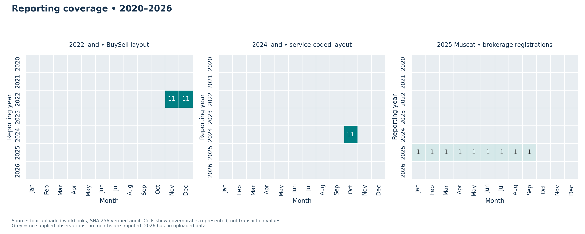

# Oman Real Estate Market Analysis (2020–2026)

## Project overview

A professional, reproducible analytics portfolio project investigating the Sultanate of Oman's real estate market using real, verified public data. Python, Excel and Power BI will support analysis and communication. The 2020–2026 window is a research target: actual coverage will follow reliable source availability, and incomplete 2026 periods will be labelled explicitly.

## Business problem

Developers, investors and business decision-makers need comparable evidence on transaction activity, regional demand and price indicators. Differences in definitions, reporting frequencies and historical coverage must be resolved before drawing conclusions or identifying potential investment opportunities.

## Research objectives and questions

- Track market evolution: how has the Omani market evolved between 2020 and 2026?
- Measure activity: how have transaction values and volumes changed over time?
- Compare regions: which governorates have the highest market activity?
- Study pricing: how do price indicators differ across locations and property categories?
- Identify patterns: what trends and potential investment opportunities emerge from verified evidence?
- Support decisions: what actionable insights can help developers, investors and business decision-makers?

## Planned methodology

1. Verify official sources, licences, definitions and historical coverage; build a provenance register.
2. Acquire immutable originals, record checksums and metadata, and approve a source-backed data dictionary.
3. Implement reproducible cleaning, geography/category harmonization and quality checks with tests.
4. Analyze comparable periods, transaction scopes, regional activity and price indices; document missingness and revisions.
5. Produce documented notebooks, charts, Excel outputs and a Power BI model/dashboard.
6. Communicate evidence-backed findings, limitations and business recommendations.

Separate sales from mortgages and other registrations. Do not combine national totals with regional components, sum overlapping cumulative series, infer missing observations, or equate average transaction values with property price indices. No synthetic market data or fabricated findings are used.

## Technology stack

Python **3.12**, Pandas, NumPy, Matplotlib, Seaborn, Plotly, Jupyter/JupyterLab, openpyxl and XlsxWriter for Excel exchange, Microsoft Excel, Power BI Desktop, Git/GitHub and Pytest. OpenAI Codex assists project implementation. Excel and Power BI are separate desktop applications, not pip dependencies.

## Repository structure

```text
oman-real-estate-market-analysis/
├── data/raw/manual/                 # four unchanged uploaded XLSX originals
├── data/processed/audited/<run_id>/  # unchanged PR #4 audit
├── data/processed/eda/<run_id>/      # summaries and three monthly analytical facts
├── notebooks/01_scoped_real_estate_eda.ipynb
├── src/                             # collector, aggregate adapter, row audit, validators
├── reports/data_quality_report.md
├── reports/EDA_INDEX.md
├── reports/eda/<run_id>/insights.md
├── reports/figures/eda/<run_id>/
├── powerbi/EDA_MODEL.md
├── powerbi/EDA_MEASURES.dax
├── docs/                            # sources, dictionary, geography evidence, validation
├── tests/                           # environment, collection, aggregate and row checks
├── .github/workflows/validate.yml
├── DATA_UPLOAD_GUIDE.md
├── README.md
├── requirements.txt
├── requirements-lock.txt
└── .gitignore
```

## Setup and execution

From a clone of this repository, use Python 3.12 and an isolated environment:

```bash
python3.12 -m venv .venv
source .venv/bin/activate
python -m pip install -r requirements-lock.txt
python -m src.validate_environment
python -m pytest
python -m pip check
jupyter lab
```

On Windows, create the environment with `py -3.12 -m venv .venv`, then activate it in PowerShell using `.venv\Scripts\Activate.ps1`. Execute remaining commands from the repository root.

`requirements.txt` pins direct dependencies; `requirements-lock.txt` records the full validated resolution. To deliberately refresh dependencies, install direct requirements in a fresh Python 3.12 environment, run all checks, then regenerate the lock with `python -m pip freeze > requirements-lock.txt` and review changes. The initial lock is validated on Linux/Python 3.12; validate other operating systems separately. The validator checks Python and all required imports and returns a nonzero exit code on failure. Tests cover actual imports and failure handling. Validation does not certify future data or dashboard correctness.

Install Microsoft Excel separately as needed and Power BI Desktop on a supported Windows machine. Future processed UTF-8 CSV or XLSX exports will feed these tools with documented types, units and keys. The executed EDA notebook is included; Power BI Desktop import follows the analytical model instructions.

## Data source strategy

Prioritize NCSI, the Ministry of Housing and Urban Planning and Oman official data portals. See [source register](docs/data_sources.md) for verified pages and unresolved dataset questions, and [proposed dictionary](docs/data_dictionary.md) for candidate variables. Four uploaded workbooks are now audited for limited descriptive record analysis; source URLs/licences and financial definitions remain pending. Raw and processed data are ignored by default pending provenance, size and redistribution review; `.gitkeep` preserves their directories.

## Expected deliverables

A verified source inventory and dictionary; reproducible Python preparation and analysis; documented Jupyter notebooks; static and interactive figures; Excel analysis exports; Power BI model/dashboard; a business report with traceable recommendations and limitations; automated data and pipeline tests as implementation progresses.

## Current project status

**Scoped EDA completed from merged PR #4 on latest main.** Four unchanged original workbooks provide **28,558 source record occurrences**: November/December 2022 land records, October 2024 service-coded land records, and January–September 2025 Muscat brokerage registrations. All eleven governorates are represented in each supplied land month; the brokerage scope is Muscat only.

The delivered [executed Jupyter notebook](notebooks/01_scoped_real_estate_eda.ipynb), [computed insights](reports/eda/863d9b8097310b650602/insights.md), 31 analytical CSV tables and 14 PNG/SVG figures describe geographic and categorical patterns within the supported cohorts. A [Power BI model](powerbi/EDA_MODEL.md) includes three separate monthly facts, dimensions, relationships, suggested DAX and dashboard page designs. See the [artifact index](reports/EDA_INDEX.md) for all outputs and [validation](docs/eda_validation.md) for executed checks.

```bash
python -m src.run_eda
python -m pytest
```

The pipeline verifies pinned input/output hashes, preserves all repeated source occurrences, generates separate scoped summaries/figures, and executes the notebook. See [methodology](docs/eda_methodology.md), [analytical dictionary](docs/eda_data_dictionary.md) and [input configuration](docs/eda_config.json) for every transformation and interpretation limit. Two presentation libraries provide readable Arabic figure labels; data labels/keys remain unchanged.

**What these data show:** Ad Dakhiliyah has the most supplied rows in both 2022 land snapshots; North Al Batinah leads the October 2024 snapshot. Muscat brokerage has nine supplied months and distinct property-use/description distributions. These are uploaded-record findings, not evidence of complete-market dominance, prices or investment returns.

**Limits remain:** sparse years/months, partial-year Muscat-only 2025 data, no official transaction IDs, unresolved exact source URLs/licences, unverified service-code meanings and financial units. No monetary/price conclusion, continuous 2020–2026 trend, dashboard binary or investment recommendation is claimed. The prepared Power BI model requires import into Power BI Desktop; its DAX is suggested and has not been executed there. Original audit outputs and source documentation remain intact.




## Phase 2 data discovery and collection

See the [verified coverage matrix](docs/data_availability.md), [source catalogue](docs/source_catalog.json), [acquisition attempts](docs/acquisition_manifest.json) and [pipeline instructions/completion status](docs/collection_pipeline.md). Run `python -m src.collect_data` after enabling the official hosts listed in the source register. Run `python -m src.process_data` only after downloads succeed; Poppler is required and source reconciliation remains necessary. A failed download does not create a checksum or observation. Exact publication dates remain unverified where null in the catalogue.


## Manual official Excel/CSV ingestion

Automated source retrieval remains blocked. The aggregate manual workflow remains available for future official indicator tables. The four current row-level uploads use the dedicated audit workflow above. See [DATA_UPLOAD_GUIDE.md](DATA_UPLOAD_GUIDE.md) for required governorate tables, official entry points, provenance requirements and GitHub uploads. Place unchanged originals under `data/raw/manual/` and retain source notes. [Manual metadata/validation contract](docs/manual_ingestion.md) and [current status](docs/manual_ingestion_status.json) distinguish valid imports, partial coverage and errors.

```bash
python -m src.manual_ingestion inspect
python -m src.manual_ingestion run
```

This offline workflow supports selected XLSX sheets and CSV tables, English/Arabic headers and governorate labels, explicit wide-table mappings, decimal unit conversion, duplicate provenance and coverage validation. No network requests occur. New immutable output runs use `data/processed/manual/<run_id>/` for observations, provenance, coverage and validation reports; existing collector outputs and originals remain separate. A complete all-11 gate is evaluated per comparable indicator/period/category/scope, with no fabricated missing rows.
