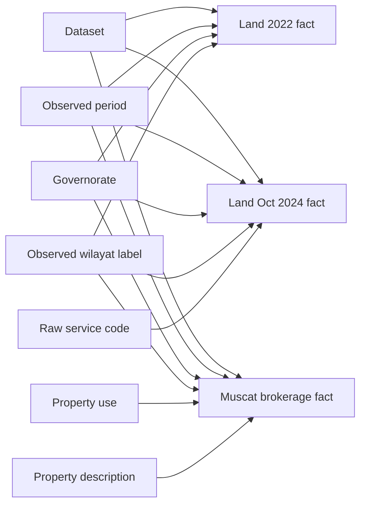

# Power BI preparation: separate monthly analytical facts

For the reproducible six-page reporting package, strict Power Query imports, verified column contract, measure checks and Desktop build/acceptance instructions, use [powerbi/README.md](README.md). That package implements this aggregate model; no PBIX or Microsoft engine execution is claimed.

Before import or further modeling, read the completed [duplicate audit](../reports/DUPLICATE_AUDIT.md) and its [criteria](../docs/duplicate_audit_methodology.md). It retains every source occurrence: no confirmed ingestion duplicates or deletion evidence was found. Full-source repeat flags include demographic fields absent from the business view and must not be labelled unique-transaction validation. Do not apply business-field Remove duplicates/DISTINCT. This audit does not change the model or facts below.

This is an import-ready analytical model, with CSVs, model instructions, DAX and page specifications. A binary PBIX is not generated or tested: Power BI Desktop is a separate Windows application. Use the notebook and Python figures as the validated analytical reference.

## Import instructions

1. Run `python -m src.run_eda` from the repository root in the locked Python 3.12 environment. Note `tables_directory` in its JSON output. [EDA artifact index](../reports/EDA_INDEX.md) points to the committed run.
2. In Power BI Desktop, Get Data → Text/CSV; import the **three `fact_*.csv` files** and `dim_*.csv` files from that one run. Use UTF-8 (65001), comma delimiter and CSV quoting. Preserve nulls and raw Arabic labels. Exports include a UTF-8 BOM for Excel.
3. Import `coverage_matrix_2020_2026.csv`, `dataset_summary.csv`, `data_quality_summary.csv` and optionally `source_column_quality.csv` separately for a coverage/quality page. They are metadata/summaries, not additional transaction facts. Do not relate coverage metadata to the main facts or add its counts to measures.
4. Set every key/code/name to Text. Set `reported_record_count` and `records_in_repeated_groups` to Whole Number; `nonstandard_wilayat_label` to Boolean; `year`/`month` to Whole Number; shares to Decimal Number (already on 0–100 scale, so **do not** apply percentage format unless divided by 100). Dates in dataset metadata use ISO yyyy-MM-dd. Do not infer types/units from filenames.
5. Create the relationships below manually, all dimension-to-fact **one-to-many, single-direction**. Disable Auto date/time. Keep scope pages separate. Never append the three facts into a national sales table.
6. Add measures from [EDA_MEASURES.dax](EDA_MEASURES.dax), create pages below, and reconcile source totals **13,168**, **6,024**, **9,366** separately before publishing. Record actual date windows and source caveats in titles/tooltips.

## Grain and measures

| Fact | Observed aggregation grain | Rows | Sum of reported_record_count |
|---|---|---:|---:|
| fact_land_2022 | dataset, observed month, governorate, wilayat, nonstandard-label flag, buyer type, owner-count band | 361 | 13,168 |
| fact_land_2024 | same plus raw service code and ownership mode | 257 | 6,024 |
| fact_brokerage_2025 | dataset, observed month, governorate, wilayat, nonstandard-label flag, property-use key, property-description key | 403 | 9,366 |

These facts contain real observed aggregates of **retained source row occurrences**. Their physical row counts are not transaction counts. `SUM(reported_record_count)` is the correct metric. Source rows with repeated visible values remain; `records_in_repeated_groups` counts occurrences participating in a repeated group, not confirmed duplicate transactions. No amounts, prices, owner sums or birth dates are exported into these facts. The brokerage registration category is constant within its dataset; its literal source label appears in the `brokerage_transaction_category.csv` summary.

## Relationships

| Dimension / key | Relates to |
|---|---|
| dim_dataset[dataset_id] | All three facts[dataset_id] |
| dim_period[period_id] | All three facts[period_id] |
| dim_governorate[governorate_id] | All three facts[governorate_id] |
| dim_wilayat[wilayat_key] | All three facts[wilayat_key] |
| dim_buyer_type[buyer_type] | Both land facts[buyer_type] |
| dim_ownership_band[ownership_band] | Both land facts[ownership_band] |
| dim_service_code[service_sub_id] | October 2024 fact[service_sub_id] only |
| dim_property_use[property_use_key] | Brokerage fact[property_use_key] only |
| dim_property_description[property_description_key] | Brokerage fact[property_description_key] only |

Do not also connect governorate to wilayat: that creates multiple filter paths. Shared dimensions filter each fact independently; DAX never sums facts together. Slice by dimension fields rather than hidden fact keys. Hide fact keys and automatic count aggregations from report authors where practical. Use `dim_dataset[scope_id]` to restrict pages to the relevant definition; dataset IDs uniquely identify the source file/version. `dim_period` has **12 observed months** with gaps; it is not a complete date table. Do not mark it as a date table or use DATEADD, SAMEPERIODLASTYEAR, annual/YTD or generic growth measures. Sort period labels by period_id and owner bands in 1, 2, 3, 4, 5+ order.

Buyer/ownership dimensions relate to the two land facts as listed above. Do not introduce bidirectional or many-to-many relationships to fix missing records; these outputs pass key and referential-integrity tests.

## Dashboard page specifications

Use a navy/teal palette with amber review flags, white background, readable Arabic font and plain titles. Label metric "Reported record occurrences" / "Reported brokerage registrations". Avoid a cross-scope grand-total card or speculative investment scores. This specification prepares a dashboard; it is not a claim that a dashboard has been built.

| Page | Layout and filtering | Interpretation |
|---|---|---|
| Coverage and quality | Top: four-file source table and verification status. Centre: governorate vs supplied period presence grid and 2020–2026 availability matrix. Bottom: repeat/missingness caveats. No transaction KPI from summing metadata. | Blank/unavailable cells are not zero activity; distinguish Muscat-only scope. |
| Land — Nov/Dec 2022 | Lock scope land_buy_sell_2022. Period, governorate, wilayat and buyer filters. Two month cards and side-by-side ranked bars with common axes; share-change table; wilayat top-ten; owner bands. | Same-layout two-snapshot comparison only. Nonstandard wilayat labels remain in totals and may be excluded only from the wilayat ranking visual. |
| Land — Oct 2024 | Lock scope land_service_coded_2024. Single-month count card, governorate/wilayat ranks, raw RN13A/RN13C mix, buyer/owner distribution. | Service meanings and monetary units unverified; no financial KPI. |
| Muscat brokerage — Jan/Sep 2025 | Lock brokerage scope and Muscat. Nine-month bar chart, six-wilayat ranks/heatmap, property-use and description bars, source-category text. | Partial-year brokerage registrations; no national or full-year growth interpretation. |
| Methodology and sources | Attribution, audit/config/manifest paths, dates, source links where verified, pending URLs/licences/definitions, methodology and refresh instructions. | Distinguish verified local bytes from independently verified source authenticity. |

A map is optional only after obtaining authoritative geometry and matching administrative keys. Current rank/coverage charts provide geographic comparisons without inventing boundaries or centroids.

## Refresh and acceptance checks

Keep every original workbook and immutable audit run. A new official source version needs a reviewed registry, audited outputs and deliberately updated EDA configuration; do not silently replace current inputs. Run full tests, review source definitions and regenerate before changing the Power BI folder source. Do not load two run folders or both raw and summarized facts into the same measures.

Acceptance: 11 governorates in each land month, Muscat only for all nine brokerage months, no missing-period zero filling, correct per-family sums, all relationship keys unique/matched, 2024 service codes literal/uninterpreted and no monetary measure. Exact source URLs/licences and land publication dates remain unresolved. Complete market coverage, unique transaction identities, continuous trends, prices and investment conclusions are not established.
